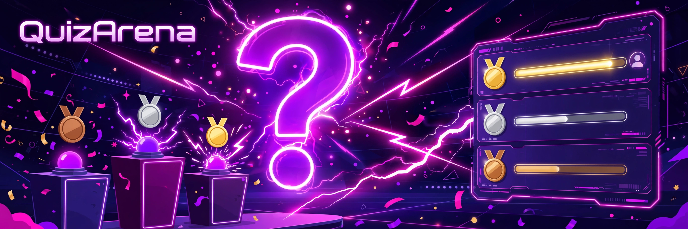

# QuizArena

[](LICENSE)
[](src/QuizArena.Api)
[](src/QuizArena.Api/Hubs)



A realtime multiplayer quiz game: create a room, share the 6-character code, and race your friends
to answer — faster correct answers earn speed bonuses, and the leaderboard updates live after every
question.

## Features

- **Rooms** — create/join with short shareable codes; lobby shows players as they join
- **Bundled question sets** — General Knowledge and Science Sprint (10 questions each), seeded at startup
- **Live game flow via SignalR** — question broadcast with countdown, answer submission,
  server-side per-question timer, correct answer reveal, live leaderboard, final standings
- **Scoring with speed bonus** — 100 base points + up to 100 bonus scaled by remaining time
- **Playable web UI** — host/player views with a live timer bar and medals, using a hand-written
  minimal SignalR JSON-protocol client (`signalr-mini.js`): no npm, no CDN, no build step
- **REST companions** — list question sets, inspect public room state

## Tech stack

- ASP.NET Core 8 + SignalR, EF Core + SQLite (question sets seeded at startup; live rooms in memory)
- Vanilla HTML/CSS/JS frontend in `wwwroot/`
- xUnit tests covering scoring math, room lifecycle, and a full simulated game

## How to run

```bash
dotnet run --project src/QuizArena.Api
```

Open `http://localhost:5000` in two browser windows: create a room in one, join with the code in
the other, and hit **Start game** as the host.

```bash
# question sets
curl http://localhost:5000/api/questionsets

# public room state
curl http://localhost:5000/api/rooms/ABC123
```

## How to test

```bash
dotnet test
```

## Project layout

```
src/QuizArena.Api/
  Models/        Question, QuestionSet, RoomSession, PlayerState
  Data/          EF Core DbContext + seeded question sets
  Services/      QuizGameService (rooms, timers, scoring, leaderboard)
  Hubs/          QuizHub (thin SignalR adapter)
  Controllers/   QuestionSetsController, RoomsController
  wwwroot/       index.html, style.css, app.js, signalr-mini.js
tests/QuizArena.Tests/
  QuizGameServiceTests (full simulated game), QuizArenaApiTests
```
